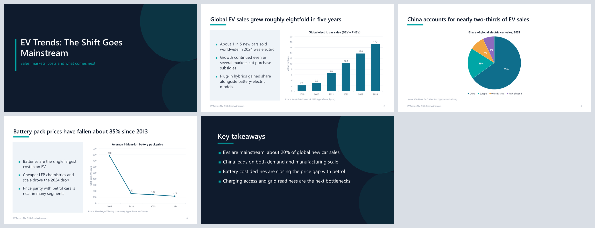

# Generative Slide Assistant

Type a prompt such as **"Make a 5-slide deck on EV trends"** and get back a PowerPoint deck. The deck has insight-driven headings, bullets, native (editable) charts, stat callouts and speaker notes. The content is written by an LLM (Claude or GPT) and the deck is rendered with `python-pptx`. You can use it through a Streamlit app or a CLI.



## Deliverables

| Deliverable | Where |
|---|---|
| Prompting framework for slide content | [`slide_assistant/prompts.py`](slide_assistant/prompts.py) · write-up in [`docs/PROMPTING_FRAMEWORK.md`](docs/PROMPTING_FRAMEWORK.md) |
| Auto-generation of slides with headings, bullets, charts | [`slide_assistant/builder.py`](slide_assistant/builder.py) (9 layouts, 5 chart types, 4 themes) |
| Sample decks | [`samples/decks/`](samples/decks) (`.pptx`), [`samples/specs/`](samples/specs) (JSON), [`samples/previews/`](samples/previews) (PNG) |
| Codebase | this folder (Streamlit app, CLI, library, 24 tests) |
| Summary video walkthrough | script and shot list in [`docs/VIDEO_WALKTHROUGH.md`](docs/VIDEO_WALKTHROUGH.md) (recording to be made from it) |

## Architecture

```
"Make a 5-slide deck on EV trends"
        │
        ▼
 parse_request ──► topic="EV trends", slides=5, audience, tone, charts on/off
        │
        ▼
 Stage 1  LLM ──► outline  {storyline, [title, layout, purpose] × N}      (optional)
        │
        ▼
 Stage 2  LLM ──► deck JSON (structured outputs / JSON Schema)
        │
        ▼
 Pydantic validation ──fail──► repair prompt with exact errors (≤ 2 retries)
        │ pass
        ▼
 Quality lint (bullet limits, chart sanity, source notes)
        │
        ▼
 python-pptx renderer ──► .pptx  (themes, native charts, speaker notes)
```

The LLM only writes **content**. **Layout** is handled entirely by code, so the decks look consistent and always open correctly in PowerPoint.

```
slide_assistant/
├── app.py                    Streamlit UI
├── generate.py               CLI
├── slide_assistant/
│   ├── prompts.py            prompting framework (system prompt, stage prompts, repair)
│   ├── schema.py             Pydantic deck model + strict JSON Schemas for the APIs
│   ├── llm.py                Claude / OpenAI / offline-demo providers
│   ├── pipeline.py           orchestration: outline → content → validate/repair → lint
│   ├── quality.py            post-generation slide hygiene
│   ├── builder.py            python-pptx renderer (layouts, charts, notes)
│   ├── themes.py             colour/font themes
│   └── demo_content.py       offline template content
├── samples/                  sample decks (pptx, json, png previews)
├── scripts/                  build_samples.py, export_thumbnails.ps1, contact_sheet.py
├── docs/                     prompting framework + video walkthrough script
└── tests/                    pytest suite (incl. mocked API tests + headless UI test)
```

## Setup

```bash
cd slide_assistant
pip install -r requirements.txt
cp .env.example .env        # then add ANTHROPIC_API_KEY and/or OPENAI_API_KEY
```

## Usage

### Streamlit app
```bash
streamlit run app.py
```
1. In the sidebar, pick a provider: **Claude**, **GPT**, or **Demo (offline)**. For Claude or GPT, paste an API key there unless it's already in `.env`. Demo needs no key.
2. Enter a prompt and click **Generate deck**. Say the slide count in the prompt ("Make a 5-slide deck on …"); otherwise you get 6 slides.
3. Preview the slides (including the charts), edit the JSON spec if you want, then **download the .pptx**.

The app always uses the `midnight` theme, charts on, and outline-first planning. To change the theme, audience, tone or slide count, use the CLI flags below.

You can also load any sample from the "load a sample deck" dropdown without calling an LLM.

### CLI
```bash
python generate.py "Make a 5-slide deck on EV trends" --provider claude
python generate.py "Pitch deck for a meal-kit startup" --provider openai --slides 8 --theme sunset --save-spec
python generate.py "Intro to cybersecurity" --provider demo                  # offline
python generate.py --from-spec samples/specs/ev_trends.json --theme fresh    # re-render a spec
```
Other flags: `--model`, `--audience`, `--tone`, `--no-charts`, `--single-stage`, `--out`.

### As a library
```python
from slide_assistant import generate_deck, render_deck
from slide_assistant.llm import get_provider

deck, log = generate_deck("Make a 5-slide deck on EV trends", get_provider("claude"))
render_deck(deck, "ev.pptx", theme="midnight")
```

## Features

- **Layouts:** `title`, `section`, `bullets`, `chart`, `bullets_chart`, `two_column`, `stats`, `quote`, `closing`. The model chooses one per slide.
- **Charts:** native PowerPoint column, bar, line, pie and doughnut charts with themed colours, data labels, axis titles, legends and a source note. You can edit the data in PowerPoint with *Right-click → Edit Data*.
- **Themes:** `midnight`, `corporate`, `fresh`, `sunset`.
- **Speaker notes** on every slide.
- **Data honesty:** charts must cite a source and year, or be labelled "Illustrative data".
- **Robustness:** strict structured outputs, Pydantic validation, an automatic repair loop, quality lint, and friendly errors for missing keys, rate limits and refusals.

## LLM providers

| Provider | Default model | Mechanism |
|---|---|---|
| Claude (`anthropic` SDK) | `claude-opus-5-5` (effort `medium`) | `output_config.format` JSON Schema; server-side refusal fallback (`fallbacks="default"`) |
| OpenAI (`openai` SDK) | `gpt-4o` | `response_format` `json_schema`, `strict: true` |
| Demo | none (offline) | template content for trying the app without a key |

To override a model, use the sidebar, `--model`, or the `CLAUDE_MODEL` / `OPENAI_MODEL` environment variables.

## Sample decks

| Deck | Slides | Theme | Highlights |
|---|---|---|---|
| `ev_trends.pptx` | 5 | midnight | Column, pie and line charts with approximate public data (IEA, BNEF) |
| `saas_quarterly_review.pptx` | 7 | corporate | Stats callouts, multi-series column chart, two-column. Fictional company |
| `cloud_migration.pptx` | 6 | fresh | Doughnut and horizontal bar charts, phased plan. Illustrative data |

To regenerate them: `python scripts/build_samples.py` re-renders the committed specs. `python scripts/build_samples.py --provider claude` (or `openai`) regenerates them from their prompts with a live model.

> **Note:** The committed sample specs were written in the same JSON format the LLM produces, then rendered by the real pipeline. The EV figures are approximate values from IEA and BNEF publications, so verify them before external use.

## Tests
```bash
pytest -q
```
There are 24 tests. They cover request parsing, schema strictness, the lint rules, the end-to-end pipeline, the repair loop, rendering of every sample in every theme, the **Claude and OpenAI adapters against mocked HTTP** (request shape, refusal and auth errors), and a **headless run of the Streamlit app**.

To render slide images for review on Windows with PowerPoint installed, run `powershell -File scripts/export_thumbnails.ps1 <deck.pptx> <out_dir>`.
